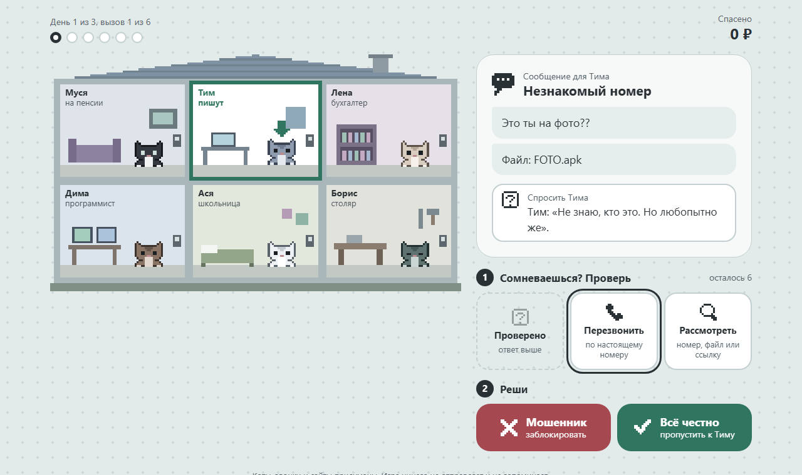

# Кот на проводе

Игра про телефонных и сетевых мошенников. Все звонки и сообщения дома идут через тебя: честные пропускай, обман блокируй.

**[Играть](https://yasavok.github.io/kot-na-provode/)**: в браузере, без установки и регистрации.



## Как играть

1. **Прочитай**, кто пишет и чего хочет.
2. **Проверь**, если сомневаешься: спроси жильца, перезвони по настоящему номеру или рассмотри отправителя. Проверок меньше, чем хочется.
3. **Реши**: пропустить или заблокировать.

Игра идёт три дня, и с каждым днём обмана больше. Пропустишь мошенника, и кот потеряет деньги, а завтра ему напишут снова: обманутых ищут повторно. Заблокируешь честный вызов, и кот останется без важного. После каждого решения игра объясняет, по каким признакам это можно было понять.

С клавиатуры: `1`, `2`, `3` для проверок, `←` заблокировать, `→` пропустить.

## Зачем

Советы «не верь незнакомцам» не работают, потому что обман выглядит как обычное сообщение. Здесь можно ошибиться бесплатно и привыкнуть к главному: не уверен — проверь сам, по другому каналу.

Люди, номера и сайты придуманы. Игра ничего не отправляет и не хранит.

## Добавить свою ситуацию

Все вызовы лежат в [`data/calls.js`](data/calls.js), программировать не нужно. Как это сделать, написано в [CONTRIBUTING.md](CONTRIBUTING.md).

## Запуск у себя

Сборки и зависимостей нет: открой `index.html` в браузере. Проверка базы вызовов, нужен Node 20+:

```
npm test
```

| Файл | Что внутри |
| --- | --- |
| `data/calls.js` | жильцы и вызовы |
| `js/app.js` | ход игры |
| `js/pixel.js` | дом, коты и значки, нарисованные кодом |
| `test/` | проверки базы |

Параметр `?seed=5` в адресе делает порядок вызовов повторяемым.

## Лицензия

[MIT](LICENSE)
